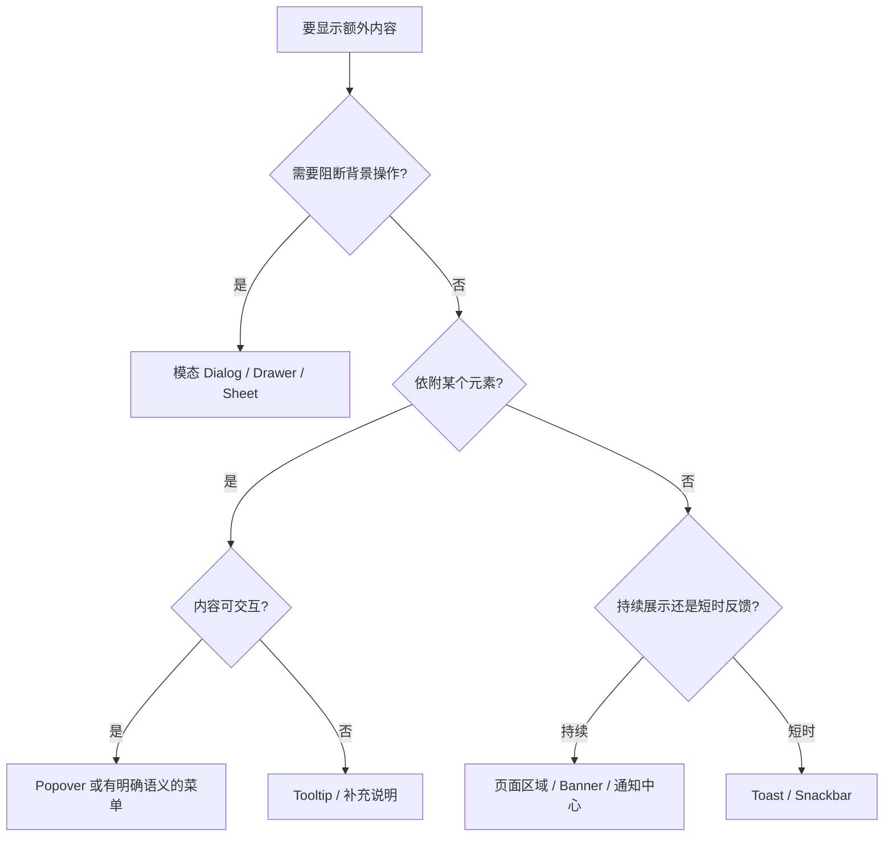

# 01 · 浮层：先判断任务，再选择容器

> **适用**：需要一个「点了弹出点东西」的容器时：在 Dialog、Drawer、Popover、Tooltip、Toast、Banner 之间选，并交代开合、焦点与层级。
> **不适用**：容器已定，只处理开合时序、跟随定位、软键盘或子浮层（12），或只给动效定时长与状态（06）时。
> **读完能判定**：这次要不要阻断背景操作、该用哪个容器；反馈走 Toast 还是 Banner、结束后能否回看；该弹确认框还是用撤销兜住；z-index 调到再大也没用时先查什么；开与关是否构成一份完整契约。

[系列目录](../../README.md) · 下一篇：[导航与表单](02-导航与表单.md)

项目列表里有三个动作：悬停查看字段解释、点击查看项目详情、删除项目。它们都能做成“弹出一个框”，但需要的行为不同。先讨论行为，组件名才有意义。

## 先问四个问题

1. 用户处理它时，还需不需要操作背后的页面？
2. 内容是不是依附在某个按钮或字段旁边？
3. 内容里有没有输入框、链接或操作按钮？
4. 它怎么结束：移开、主动关闭、完成任务，还是一段时间后消失？

**Modal 是一种交互模式，Dialog 是一种容器。** Dialog 可以是模态，也可以是非模态。Drawer、Sheet 同样可能阻断页面，也可能与页面并排工作。遮罩只是视觉表现；真正的模态还要阻止背景交互、管理焦点。

这张图缩小选择范围。最终还要考虑任务长度、屏幕空间和组件库已经提供的键盘行为。

## 容器、模式与用途

| 名称 | 核心含义 | 项目页里的例子 |
|---|---|---|
| Dialog | 独立对话区域，可模态或非模态 | 修改项目名称 |
| Alert dialog | 需要立即关注并回应的简短重要对话 | 确认删除仍有成员的项目 |
| Full-screen dialog | 占满可用屏幕的对话容器 | 小屏上的复杂编辑 |
| Drawer / Side sheet | 贴边面板，是否模态另定 | 保留列表上下文的详情 |
| Bottom sheet | 从底部呈现的面板 | 手机上筛选项目 |
| Action sheet | 供用户选择动作的面板 | 拍照、相册、选择文件 |
| Popover | 与锚点关联的浮出区域 | 选择日期、调整颜色 |
| Tooltip | 聚焦或悬停时出现的简短说明 | 解释一个陌生图标 |
| Hovercard | 悬停出现的富内容卡片 | 查看项目负责人的名片 |
| Context menu | 针对当前位置或对象的操作菜单 | 右键归档、复制链接 |
| Command palette | 可搜索的命令入口 | 搜索项目并执行跳转 |
| Lightbox | 放大查看图片或媒体的容器 | 查看上传截图 |

这些名字并非跨库统一标准。看到 `Popover`，还要查它是否会移动焦点、是否支持点击外部关闭。HTML 的 Popover API、ARIA 的 dialog 角色和某个 UI 库的同名组件，也不是同一层概念。

导航抽屉常分 temporary、persistent、permanent：临时覆盖、可持续展开、永久可见。后两者可能参与页面布局，不能套用模态焦点锁定。

## Tooltip 小，约束却不少

Tooltip 通常不包含可聚焦的交互内容，本身也不接收焦点。需要按钮或链接时，选可交互的浮层，并明确它的焦点与关闭规则。

“没有按钮”不等于“鼠标一离开触发器就关闭”。对于由悬停或聚焦触发的额外内容，WCAG 1.4.13 在适用时要求它可关闭、可悬停、可持续：指针移到提示内容上时仍能查看；触发条件还在时，不应因短倒计时消失。相关例外见原标准。

图标按钮的可访问名称也不能只靠 Tooltip 提供。比如关闭按钮即使提示还没出现，也应有“关闭详情”的名称。

## 反馈选 Toast 还是 Banner

| 形式 | 适合的消息 | 结束方式 |
|---|---|---|
| Toast | “链接已复制”一类低风险结果 | 通常短时显示 |
| Snackbar | “已归档”，并附撤销等操作 | 依实现与用户操作决定 |
| Banner / Inline alert | “连接已中断，修改尚未保存” | 问题解决或用户明确处理 |
| Notification | 可回顾的消息、异步任务结果 | 可关闭，也可能自动收起并进入消息中心 |

这些名称有重叠。**需要处理的信息应有持续可找的入口。** 上传失败只弹三秒，用户恰好离开屏幕，回来就不知道该重试什么。

带撤销的消息要给足操作机会，处理好悬停和聚焦时的计时，并考虑时间限制的无障碍要求。自动消失时间不能只按“Toast 就是三秒”拍板。

## 打开和关闭是一份完整契约

以“编辑项目”为例：

- 打开前记住触发按钮；打开后将焦点放到合适位置，例如标题或首个字段。
- 模态时限制焦点在内部，背景不可操作；支持明确的关闭按钮。
- 通常支持 Esc。若存在未保存修改，关闭动作进入明确的保留或放弃流程。
- 点击遮罩是否关闭要单独约定。不能因用户误点就丢失编辑内容。
- 关闭后通常把焦点交回触发按钮；若项目已删除，交给列表中合理的后续位置。

删除操作也不必一律弹确认框。可恢复、低风险操作常可用撤销减少打断；不可恢复或后果严重的操作需要说明对象与后果。按钮写“删除项目”，比“确定”更容易检查。

## z-index 为什么调到一万还没用

`z-index` 只在对应的层叠上下文中比较。祖先的 `transform`、`opacity`、定位等可能创建新上下文；子元素即使写一万，也可能盖不过另一个上下文里的面板。先检查祖先，再考虑 Portal 挂载位置。

原生模态 `<dialog>` 的 `showModal()` 和打开的原生 Popover 会进入浏览器 top layer；普通页面元素不能靠更大的 `z-index` 直接越过它。嵌套菜单应设计好挂载方式。

可以集中约定页面、浮层、全局反馈的层级，但不要规定“Toast 永远最高”。模态期间无关的背景通知可能需要延后；当前对话中的错误通常更适合放在对话内部。

## 继续看开合与定位

组件选对之后，还需要处理快速开关、离场卸载、滚动跟随、手机软键盘和子浮层事件。这些实现细节见[第 12 篇](12-浮层的开合与定位.md)。

## 做完后实际试一次

仅用键盘打开编辑、切换字段、展开日期选择器、关闭日期选择器、关闭编辑，观察焦点是否合理返回。再试一次未保存关闭。只截图检查，发现不了这些问题。

参考：[APG Dialog](https://www.w3.org/WAI/ARIA/apg/patterns/dialog-modal/)、[APG Tooltip](https://www.w3.org/WAI/ARIA/apg/patterns/tooltip/)、[WCAG 1.4.13](https://www.w3.org/WAI/WCAG22/Understanding/content-on-hover-or-focus.html)、[MDN 层叠上下文](https://developer.mozilla.org/en-US/docs/Web/CSS/CSS_positioned_layout/Stacking_context)。
