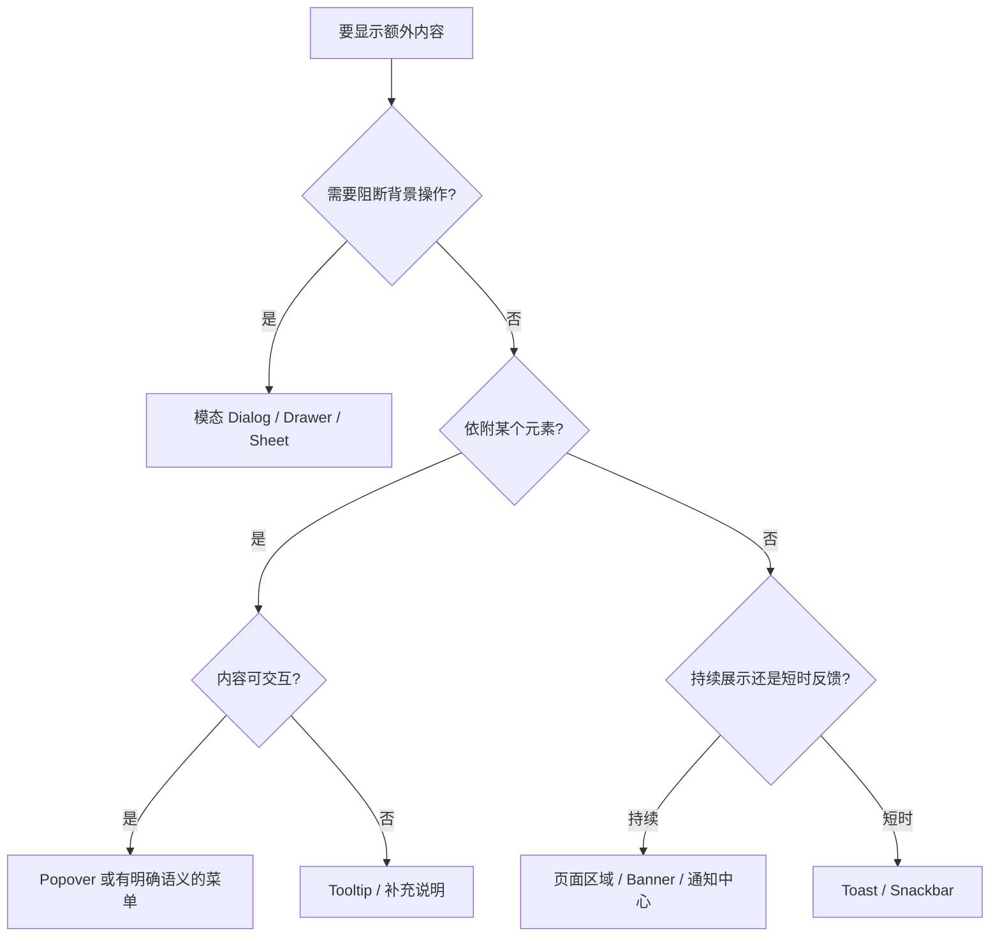

# 01 · 浮层：先判断任务，再选择容器

> **适用**：需要一个「点了弹出点东西」的容器时：在 Dialog、Drawer、Popover、Tooltip、Toast、Banner 之间选，并交代开合、焦点与层级。
> **本轮不可交付时**：若容器已经选定、这一轮只处理开合时序、跟随定位、软键盘或子浮层，停下并说明「容器已定」，改读 [12-浮层的开合与定位](12-浮层的开合与定位.md)；若只给动效定时长与状态，改读 [06-状态动效与性能](06-状态动效与性能.md)。
> **读完能判定**：这次要不要阻断背景操作、该用哪个容器；反馈走 Toast 还是 Banner、结束后能否回看；该弹确认框还是用撤销兜住；z-index 调到再大也没用时先查什么；开与关是否构成一份完整契约。

## 一、先判

容器名不决定行为：项目列表里悬停查看字段解释、点击查看项目详情、删除项目，都能做成“弹出一个框”，需要的行为却不同——先定行为，组件名才有意义。

1. **要不要阻断背景操作**：需要 → 模态 Dialog / Drawer / Sheet；不需要 → 按第 2、3 条继续分。**Modal 是一种交互模式，Dialog 是一种容器**，Dialog 可以是模态也可以是非模态；Drawer、Sheet 同样可能阻断页面，也可能与页面并排工作。遮罩只是视觉表现，真正的模态还要阻止背景交互、管理焦点。
2. **内容依附在某个按钮或字段旁吗**：依附、且内容里有输入框、链接或操作按钮（可交互）→ Popover 或有明确语义的菜单；依附、而内容只是补充说明 → Tooltip。
3. **既不阻断也不依附**：持续展示 → 页面区域 / Banner / 通知中心；短时反馈 → Toast / Snackbar。
4. **它怎么结束**：移开、主动关闭、完成任务，还是一段时间后消失——结束方式决定要不要给撤销和持续入口。
5. Tooltip 通常不包含可聚焦的交互内容，本身也不接收焦点 → 需要按钮或链接时选可交互的浮层，并明确它的焦点与关闭规则。
6. “没有按钮”不等于“鼠标一离开触发器就关闭”：悬停或聚焦触发的额外内容，WCAG 1.4.13 在适用时要求可关闭、可悬停、可持续——指针移到提示内容上时仍能查看，触发条件还在时不因短倒计时消失。
7. 图标按钮的可访问名称不能只靠 Tooltip 提供 → 关闭按钮即使提示还没出现，也应有“关闭详情”的名称。
8. **反馈选 Toast 还是 Banner**：低风险结果 → Toast；带撤销 → Snackbar；需要处理的信息 → Banner / Inline alert，且必须留一个持续可找的入口；可回顾的消息与异步任务结果 → Notification。
9. **删除不必一律弹确认框**：可恢复、低风险操作 → 用撤销减少打断；不可恢复或后果严重 → 确认框说明对象与后果。按钮写“删除项目”，比“确定”更容易检查。
10. **开与关是一份完整契约**：打开前记住触发按钮，打开后把焦点放到合适位置（标题或首个字段）；模态时限焦点在内部、背景不可操作、有明确关闭按钮；通常支持 Esc，存在未保存修改时关闭进入明确的保留或放弃流程；点击遮罩是否关闭要单独约定；关闭后焦点交回触发按钮，项目已删除则交给列表中合理的后续位置。
11. **`z-index` 调到一万还没用** → 先查祖先：`transform`、`opacity`、定位都可能创建新的层叠上下文，子元素写一万也可能盖不过另一个上下文里的面板；确认上下文之后再考虑 Portal 挂载位置。
12. 原生模态 `<dialog>` 的 `showModal()` 和打开的原生 Popover 会进入浏览器 top layer → 普通页面元素不能靠更大的 `z-index` 直接越过它，嵌套菜单要设计好挂载方式。
13. 层级可以集中约定页面、浮层、全局反馈，但不规定“Toast 永远最高”：模态期间无关的背景通知可能需要延后，当前对话中的错误通常更适合放在对话内部。
14. 导航抽屉常分 temporary、persistent、permanent（临时覆盖、可持续展开、永久可见）→ 后两者可能参与页面布局，不能套用模态焦点锁定。

## 二、做完的标准

- [ ] 这次容器的选择能用「任务长度、屏幕空间、组件库已有的键盘行为」三条说明，而不是只说组件名。
- [ ] 仅用键盘打开编辑、切换字段、展开日期选择器、关闭日期选择器、关闭编辑，焦点每次都合理返回；再试一次未保存关闭——只截图检查发现不了这些问题。
- [ ] 打开与关闭按一份契约走一遍：Esc、关闭按钮、点遮罩三条路径各一次，结果与第一节第 10 条的约定一致。
- [ ] 需要用户处理的那条信息（如上传失败），离开屏幕再回来时仍有入口。
- [ ] 出现盖不住的问题时，先查过祖先是否创建层叠上下文，再决定要不要加 `z-index`。

## 三、依据与数值

- WCAG 1.4.13（悬停或聚焦触发的内容）是标准要求，相关例外见原标准。
- “Toast 就是三秒”是平台约定与示例值，不是标准：带撤销的消息要给足操作机会，处理好悬停和聚焦时的计时，并考虑时间限制的无障碍要求。
- `z-index` 的一万是示例值，只用来说明层叠上下文，不构成层级建议。
- 组件名不是标准：看到 `Popover` 还要查它是否会移动焦点、是否支持点击外部关闭；HTML 的 Popover API、ARIA 的 dialog 角色和某个 UI 库的同名组件，也不是同一层概念。

## 四、控件、表格与示例

这张图缩小选择范围，最终还要考虑任务长度、屏幕空间和组件库已经提供的键盘行为：

容器与用途：

| 名称 | 核心含义 | 项目页里的例子 |
|---|---|---|
| Dialog | 独立对话区域，可模态或非模态 | 修改项目名称 |
| Alert dialog | 需要立即关注并回应的简短重要对话 | 确认删除仍有成员的项目 |
| Full-screen dialog | 占满可用屏幕的对话容器 | 小屏上的复杂编辑 |
| Drawer / Side sheet | 贴边面板，是否模态另定 | 保留列表上下文的详情 |
| Bottom sheet | 从底部呈现的面板 | 手机上筛选项目 |
| Action sheet | 供用户选择动作的面板 | 拍照、相册、选择文件 |
| Popover | 与锚点关联的浮出区域 | 选择日期、调整颜色 |
| Tooltip | 聚焦或悬停时出现的简短说明 | 解释一个陌生图标 |
| Hovercard | 悬停出现的富内容卡片 | 查看项目负责人的名片 |
| Context menu | 针对当前位置或对象的操作菜单 | 右键归档、复制链接 |
| Command palette | 可搜索的命令入口 | 搜索项目并执行跳转 |
| Lightbox | 放大查看图片或媒体的容器 | 查看上传截图 |

反馈形式：

| 形式 | 适合的消息 | 结束方式 |
|---|---|---|
| Toast | “链接已复制”一类低风险结果 | 通常短时显示 |
| Snackbar | “已归档”，并附撤销等操作 | 依实现与用户操作决定 |
| Banner / Inline alert | “连接已中断，修改尚未保存” | 问题解决或用户明确处理 |
| Notification | 可回顾的消息、异步任务结果 | 可关闭，也可能自动收起并进入消息中心 |

这些名称有重叠：**需要处理的信息应有持续可找的入口。**

## 五、失败长相与边界

- **上传失败只弹三秒，用户恰好离开屏幕，回来就不知道该重试什么** → 需要处理的信息缺少持续可找的入口。
- **误点遮罩，编辑内容丢了** → 点击遮罩是否关闭没有单独约定；不能因用户误点就丢失编辑内容。
- **关掉后焦点落回文档开头** → 关闭时没把焦点交回触发按钮，对象已删除时也没交给列表中合理的后续位置。
- **按钮只有 Tooltip 一个名字** → 提示未出现时按钮无可访问名称。
- **`z-index` 加上去仍然盖不住** → 祖先创建了层叠上下文，或目标是 top layer 里的原生 `<dialog>` / Popover。
- **模态弹窗后面的通知还在弹** → 层级约定写成了“Toast 永远最高”。
- **边界**：遮罩只是视觉表现，不是模态的判据；导航抽屉的 persistent / permanent 参与页面布局，不能套用模态焦点锁定；Tooltip 本身不接收焦点，需要交互就换可交互浮层；自动消失时间不能只按“Toast 就是三秒”拍板。

参考：[APG Dialog](https://www.w3.org/WAI/ARIA/apg/patterns/dialog-modal/)、[APG Tooltip](https://www.w3.org/WAI/ARIA/apg/patterns/tooltip/)、[WCAG 1.4.13](https://www.w3.org/WAI/WCAG22/Understanding/content-on-hover-or-focus.html)、[MDN 层叠上下文](https://developer.mozilla.org/en-US/docs/Web/CSS/CSS_positioned_layout/Stacking_context)。
