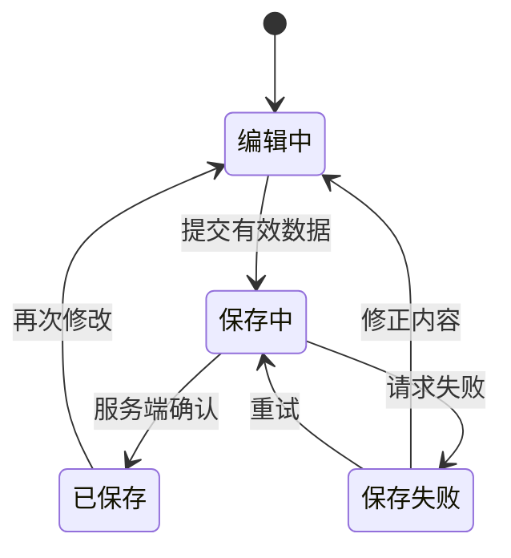

# 06 · 状态、动效与性能：让等待和失败有交代

> **适用**：要交代一次操作的等待与失败：点保存没反应、重复提交、长任务没进度、空态与失败共用一张图，或要给动效定时长、按减少动效降级、用测量而不是感觉判断性能时。
> **本轮不可交付时**：若这一轮要设计浮层开合被打断、定位跟随这类组件级动画，停下并说明「属浮层生命周期」，改读 [12-浮层的开合与定位](12-浮层的开合与定位.md)；若是输入框、按钮、列表各自的手感，改读 [09](09-输入框的手感.md)、[10](10-按钮与选择器.md) 或 [11](11-表格与列表.md)。
> **读完能判定**：这次操作有哪些状态、保存中要不要挡重复提交、超时后靠幂等还是查询定结果；这一等该给多重的反馈、哪里不能编百分比；空/无结果/无权限/加载失败/部分失败/离线各自说什么、下一步是什么；这类操作能否乐观更新、失败怎么恢复；动效多长、减少动效后什么必须留下；性能瓶颈在接口、主线程、布局还是装饰动画。

## 一、先判

1. **先把状态画出来，再补动画**：一次保存至少经历“编辑中 → 保存中 → 已保存 / 保存失败”（图见第四节）；只给最终结果、不给中间态，界面就没有可看的反馈。
2. **保存中立即给出反馈，并按业务需要阻止重复提交**：超时不等于服务端一定没保存，付款、创建记录等操作还需幂等或查询结果，不能仅靠禁用按钮保证正确性。
3. **反馈强度按等待时长分档**（表见第四节）：很快返回就保持即时按压反馈，短时请求用按钮内 Loading，内容首次加载用 Skeleton，长任务给进度、取消、后台执行与结果入口。
4. **不知道总量就用不确定进度，不要编造“99%”**；知道上传字节数时可以显示上传进度，但上传完成后还有解析阶段，应另行说明。
5. **Skeleton 只表达内容结构并预留空间，不会自动消除 CLS**：图片尺寸、字体替换和异步插入内容仍会导致跳动。
6. **“空”和“失败”不能共用一张图**：首次为空、搜索无结果、无权限、加载失败、部分失败、离线各有文案与后续动作（表见第四节）。
7. **错误说明“发生什么、影响什么、如何恢复”**：简短道歉可以符合产品语气，但不能替代这些信息；禁用动作的原因尽量就近展示，不要只藏在无法聚焦的按钮 Tooltip 中。
8. **乐观更新只在低风险、高成功率、可回滚时用**（例如收藏）：失败后应恢复状态并给出解释；若用户在等待时又做了修改，不能粗暴回滚覆盖新操作；删除资金记录、付款等场景不能仅凭“看起来更快”采用同样策略。
9. **动效时长按场景取档**（表见第四节）：档位是项目起点，进入可用减速曲线，离开可更快一些。
10. **多元素错开能表达顺序，但长列表不能让用户等着逐项播放**；`cubic-bezier()` 的 x 控制值须在 0–1，y 可以越界产生过冲；Spring 按刚度与阻尼模拟运动，适合跟手交互；FLIP 通过记录前后布局并反算变换实现位置动画。
11. **减少动效时保留必要状态信息**：关闭位移动画后，打开与关闭仍要清楚；进度与错误不能随装饰动画一起消失。
12. **性能先分清观察对象**：LCP 关注主要内容呈现，INP 关注交互响应，CLS 关注意外位移；动画流畅也可能有慢接口；请求快也可能因主线程阻塞导致按钮迟迟不响应。
13. **Core Web Vitals 的“良好”参考（标准方给出的参考值，不是产品合格线）**：LCP ≤ 2.5s、INP ≤ 200ms、CLS ≤ 0.1，通常按移动与桌面分别观察页面访问的第 75 百分位；一次本地测试不能直接证明真实用户已经达标。
14. **大图、代码与字体各自有代价**：为图片预留尺寸、避免延迟加载关键首屏大图；按需要拆分代码；Web font 的 `swap` 有助于尽早显示文字，也可能引发布局变化，需要匹配后备字体，`optional` 是另一种取舍。

## 二、做完的标准

- [ ] 状态机每一态都有界面表现：保存中有就地反馈，重复提交按业务需要被挡住。
- [ ] 超时路径走过一次：重试或查询后结果唯一，界面没有因为“禁用了按钮”就断定服务端没保存。
- [ ] 六种非正常态各在页面上真实出现过一次：首次为空、搜索无结果、无权限、加载失败、部分失败、离线，每种的下一步动作都能点。
- [ ] 不确定总量的位置没有假百分比；上传进度与解析阶段分开说明。
- [ ] 每个动效时长都落在第四节表的档位内；把动画关掉再走一遍，打开与关闭、进度与错误仍可辨认。
- [ ] 慢网、离线与失败响应各模拟一次，检查重复点击、取消与重试；性能分数之外，亲自确认用户能否知道任务进行到哪。
- [ ] 长列表若用了虚拟化，键盘导航、浏览器查找与读屏体验都验过，不是只看行数。
- [ ] 性能记录里四个观察对象分开写：交互响应、连续画面的帧节奏、镜像布局成本、装饰光标追赶；记录含环境、动作、实际观测与修改结论，若模拟降速，应在每次对比中保持一致并记录；只有同一台机器、同一视口、同一内容、同一输入动作的两份记录才互相比较，不把不同机器、不同内容的三次记录直接当作动画收益对比。

## 三、依据与数值

- **项目起点**：0.1 秒、1 秒、10 秒（Nielsen）是理解响应感知的经典参考，不是把控件机械对应到秒数的规范。
- **项目起点**：第四节每个时长档位都是项目起点；距离、尺寸、设备与直接操作方式都会改变合适时长，“超过 400ms 就卡”不能当成普遍判断。
- **示例值**：装饰光标的两档延迟（例如 80ms 与 320ms）是示例档位，只用于同一环境下的横向对照。

## 四、控件、表格与示例

一次保存至少经历以下变化：



| 情况 | 可以尝试 | 需要防止 |
|---|---|---|
| 很快返回 | 保持即时按压反馈，不必闪加载图 | 界面毫无响应 |
| 短时请求 | 按钮内 Loading、局部状态 | 整页遮罩阻止其他任务 |
| 内容首次加载 | 有结构依据时用 Skeleton | 骨架结构与结果差距太大 |
| 长任务 | 进度、取消、后台执行与结果入口 | 假百分比、一直转圈 |

| 状态 | 项目页文案例子 | 后续动作 |
|---|---|---|
| 首次为空 | 还没有项目 | 创建项目 |
| 搜索无结果 | 没有找到“官网”相关项目 | 清除筛选 |
| 无权限 | 你没有此项目的访问权限 | 申请权限或联系负责人 |
| 加载失败 | 项目列表未能加载 | 重试 |
| 部分失败 | 成员列表暂时不可用 | 仅重试该区域 |
| 离线 | 当前离线，显示上次同步内容 | 恢复后同步，并标明数据时间 |

| 场景 | 可尝试的时长 |
|---|---|
| 颜色、按压等微反馈 | 100–150ms |
| 小面板、提示进出 | 150–220ms |
| 抽屉、对话框 | 200–320ms |

```css
.panel { transition: transform 220ms cubic-bezier(.2, 0, 0, 1); }
@media (prefers-reduced-motion: reduce) {
  .panel { transition: none; }
}
```

## 五、失败长相与边界

- **点击“保存项目”后，按钮没变化。用户又点了三次，最后得到重复记录** → 缺少状态反馈，即使接口很快也是缺陷。
- **长任务只有一直转圈** → 没有进度、取消与结果入口；不知道总量就换不确定进度。
- **空态和失败共用一张图与一句“暂无数据”** → 用户分不清该重试还是该创建。六种状态分开写。
- **错误只说“出错了”** → 缺“影响什么、如何恢复”；禁用动作的原因藏在按钮 Tooltip 里，键盘与读屏用户拿不到，要就近展示。
- **乐观更新失败后粗暴回滚** → 覆盖了用户等待期间的新修改；恢复要区分用户的新操作。
- **骨架屏上了，页面还是跳** → Skeleton 不消除 CLS，图片尺寸、字体替换与异步插入内容仍会引入位移。
- **看到 `getBoundingClientRect()` 就断言强制布局** → `getBoundingClientRect()` 紧随 DOM 写入可能触发同步布局，但不能只看到函数名就断言每次都发生了强制布局。
- **拿“16ms 及格线”套所有设备** → 60Hz、120Hz 的帧预算不同，不给所有设备统一套一个“16ms 及格线”。
- **用两次 rAF 间隔当 INP** → 若工具没有完整交互指标，不把两次 rAF 间隔冒充 INP，也不把屏幕录制的视觉估计写成精确测量值。
- **装饰光标在 320ms 档没有严重掉帧却明显追赶即时文字** → 这属于动画设计延迟；输入字符本身迟迟不出现，则要检查输入处理与主线程，不能只缩短光标动画。
- **边界**：组件级的手感不在这里，改读 [09-输入框的手感](09-输入框的手感.md)、[10-按钮与选择器](10-按钮与选择器.md)、[11-表格与列表](11-表格与列表.md)，浮层的动画中断与定位改读 [12-浮层的开合与定位](12-浮层的开合与定位.md)；先保证组件在没有动画时仍能正确操作，再加入有助于理解变化的过渡。

参考：[Nielsen 响应时间](https://www.nngroup.com/articles/response-times-3-important-limits/)、[Core Web Vitals](https://web.dev/articles/vitals)、[MDN 减少动效](https://developer.mozilla.org/en-US/docs/Web/CSS/@media/prefers-reduced-motion)。
