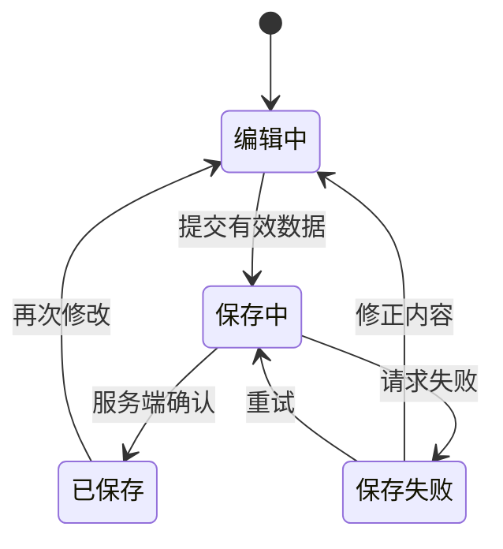

# 06 · 状态、动效与性能：让等待和失败有交代

> **适用**：要交代一次操作的等待与失败：点保存没反应、重复提交、长任务没进度、空态与失败共用一张图，或要给动效定时长、按减少动效降级、用测量而不是感觉判断性能时。
> **不适用**：要设计浮层开合被打断、定位跟随这类组件级动画（12），或输入框、按钮、列表各自的手感（09–11）时。
> **读完能判定**：这次操作有哪些状态、保存中要不要挡重复提交、超时后靠幂等还是查询定结果；这一等该给多重的反馈、哪里不能编百分比；空/无结果/无权限/加载失败/部分失败/离线各自说什么、下一步是什么；这类操作能否乐观更新、失败怎么恢复；动效多长、减少动效后什么必须留下；性能瓶颈在接口、主线程、布局还是装饰动画。

[系列目录](../../README.md) · 上一篇：[深色主题](05-深色主题.md) · 下一篇：[无障碍](07-无障碍.md)

点击“保存项目”后，按钮没变化。用户又点了三次，最后得到重复记录。即使接口很快，这也是一个缺少状态反馈的界面。

## 先画状态，再补动画

一次保存至少经历以下变化：



保存中应立即给出反馈，按业务需要阻止重复提交。超时不等于服务端一定没保存，付款、创建记录等操作还需幂等或查询结果，不能仅靠禁用按钮保证正确性。

## 等待多长，反馈多重

0.1 秒、1 秒、10 秒是理解响应感知的经典参考，不是把控件机械对应到秒数的规范。

| 情况 | 可以尝试 | 需要防止 |
|---|---|---|
| 很快返回 | 保持即时按压反馈，不必闪加载图 | 界面毫无响应 |
| 短时请求 | 按钮内 Loading、局部状态 | 整页遮罩阻止其他任务 |
| 内容首次加载 | 有结构依据时用 Skeleton | 骨架结构与结果差距太大 |
| 长任务 | 进度、取消、后台执行与结果入口 | 假百分比、一直转圈 |

不知道总量用不确定进度，不要编造“99%”。知道上传字节数时可以显示上传进度，但上传完成后还有解析阶段，应另行说明。

Skeleton 的作用是表达内容结构并预留空间，不会自动消除 CLS。图片尺寸、字体替换和异步插入内容仍会导致跳动。

## “空”和“失败”不能共用一张图

| 状态 | 项目页文案例子 | 后续动作 |
|---|---|---|
| 首次为空 | 还没有项目 | 创建项目 |
| 搜索无结果 | 没有找到“官网”相关项目 | 清除筛选 |
| 无权限 | 你没有此项目的访问权限 | 申请权限或联系负责人 |
| 加载失败 | 项目列表未能加载 | 重试 |
| 部分失败 | 成员列表暂时不可用 | 仅重试该区域 |
| 离线 | 当前离线，显示上次同步内容 | 恢复后同步，并标明数据时间 |

错误说明“发生什么、影响什么、如何恢复”。简短道歉可以符合产品语气，但不能替代这些信息。禁用动作的原因尽量就近展示，不要只藏在无法聚焦的按钮 Tooltip 中。

乐观更新适合低风险、高成功率、可回滚的操作，例如收藏。失败后应恢复状态并给出解释；若用户在等待时又做了修改，不能粗暴回滚覆盖新操作。删除资金记录、付款等场景不能仅凭“看起来更快”采用同样策略。

## 动效表达变化的来源与去向

| 场景 | 可尝试的时长 |
|---|---|
| 颜色、按压等微反馈 | 100–150ms |
| 小面板、提示进出 | 150–220ms |
| 抽屉、对话框 | 200–320ms |

这些是项目起点。距离、尺寸、设备与直接操作方式都会改变合适时长。进入可用减速曲线，离开可更快一些，但不能把“超过 400ms 就卡”当成普遍判断。

`cubic-bezier()` 描述时间与进度的关系，x 控制值须在 0–1，y 可以越界产生过冲。Spring 根据刚度与阻尼模拟运动，适合跟手交互；FLIP 通过记录前后布局并反算变换实现位置动画。多元素错开能表达顺序，但长列表不能让用户等着逐项播放。

```css
.panel { transition: transform 220ms cubic-bezier(.2, 0, 0, 1); }
@media (prefers-reduced-motion: reduce) {
  .panel { transition: none; }
}
```

减少动效时保留必要状态信息。关闭位移动画后，打开与关闭仍要清楚；进度与错误不能随装饰动画一起消失。

## 把通用动效落实到组件

输入框的平滑不只来自颜色过渡，还来自光标、输入法与布局稳定，详见[第 09 篇](09-输入框的手感.md)。按钮和选择器见[第 10 篇](10-按钮与选择器.md)，列表变化见[第 11 篇](11-表格与列表.md)，浮层的动画中断与定位见[第 12 篇](12-浮层的开合与定位.md)。先保证组件在没有动画时仍能正确操作，再加入有助于理解变化的过渡。

## 性能验收看真实使用

Core Web Vitals 的“良好”参考为 LCP ≤ 2.5s、INP ≤ 200ms、CLS ≤ 0.1；通常按移动与桌面分别观察页面访问的第 75 百分位。一次本地测试不能直接证明真实用户已经达标。

LCP 关注主要内容呈现，INP 关注交互响应，CLS 关注意外位移。动画流畅也可能有慢接口；请求快也可能因主线程阻塞导致按钮迟迟不响应。

为图片预留尺寸，避免延迟加载关键首屏大图；按需要拆分代码。长列表可以考虑虚拟化，但要检查键盘导航、浏览器查找与读屏体验，不能只用行数判断。Web font 的 `swap` 有助于尽早显示文字，也可能引发布局变化，需要匹配后备字体；`optional` 是另一种取舍。

验收时模拟慢网、离线与失败响应，检查重复点击、取消和重试。性能工具的分数之外，还要亲自确认用户能否知道任务进行到哪。

## 录一次输入，再决定改哪里

用一个固定页面做一次可重复的操作观察：固定浏览器、视口、文本和输入动作，分别录制原生光标与两档不同延迟的装饰光标（例如 80ms 与 320ms）。不要把不同机器、不同内容的三次记录直接当作动画收益对比。

1. 打开浏览器开发工具的 Performance，开始录制；在输入框连续输入同样的英文，再从中间修改，停止录制。先使用默认设置，若模拟降速，应在每次对比中保持一致并记录。
2. 找到输入事件附近的主线程任务，检查事件处理之后是否还有长计算、样式计算与布局。展开调用来源，区分业务计算与镜像测量；`getBoundingClientRect()` 紧随 DOM 写入可能触发同步布局，但不能只看到函数名就断言每次都发生了强制布局。
3. 观察帧轨迹与呈现时序，检查是否出现长帧或明显停顿。60Hz、120Hz 的帧预算不同，不给所有设备统一套一个“16ms 及格线”。需要时使用绘制提示检查是否有无关区域反复重绘，使用图层工具核实合成情况。
4. 单独观察装饰光标相对即时文字的落后。320ms 可以没有严重掉帧却明显追赶；这属于动画设计延迟。输入字符本身迟迟不出现，则要检查输入处理与主线程，不能只缩短光标动画。
5. 记录环境、动作、实际观测与修改结论。若工具没有完整交互指标，不把两次 rAF 间隔冒充 INP，也不把屏幕录制的视觉估计写成精确测量值。

这组步骤教的是如何取证，文中没有预填虚构的性能收益。交互响应、连续画面的帧节奏、镜像布局成本、装饰光标追赶，是四个不同的观察对象。完整操作案例与本轮实际功能检查记录见[第 08 篇](08-落地与验收.md)。

参考：[Nielsen 响应时间](https://www.nngroup.com/articles/response-times-3-important-limits/)、[Core Web Vitals](https://web.dev/articles/vitals)、[MDN 减少动效](https://developer.mozilla.org/en-US/docs/Web/CSS/@media/prefers-reduced-motion)。
