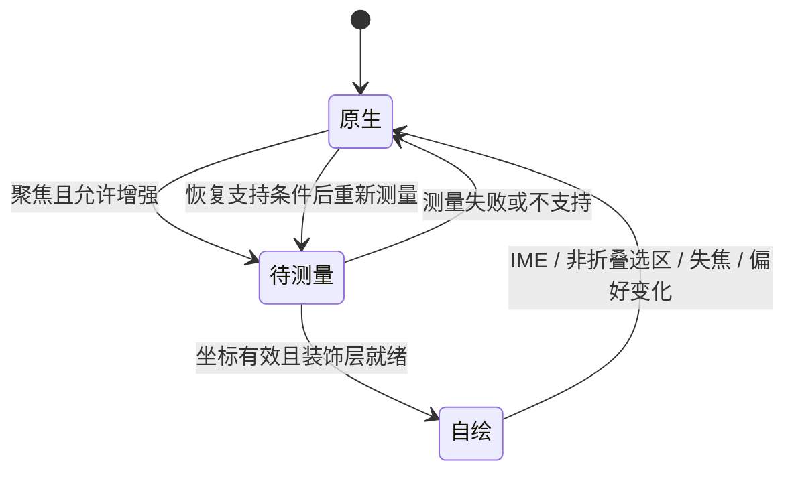

# 13 · 平滑光标：让插入点移动连续，也保留原生编辑能力

> **适用**：输入框的原生编辑行为已经稳定，要决定是否给插入点加平滑位移动画，以及加完会不会出现跟随滞后、与输入法候选窗不一致、两条光标互相闪的问题时。
> **本轮不可交付时**：若输入框本身还有打字卡顿、受控输入重建、输入法中断，停下并说明「基础手感未过关」，改读 [09-输入框的手感](09-输入框的手感.md)，本篇留到之后。
> **读完能判定**：是否只替换插入点的视觉表现、把输入与选区与撤销继续交给原生控件；接管与降级的时序、卸载时清理什么；镜像测量要同步哪些因素、缓存键包含什么；rAF 能减少什么、不能消除什么；哪些场景必须保留原生表现，哪些参数只是候选而非标准。

## 一、先判

1. **先分清是哪个「光标」**：鼠标指针（cursor）与文本插入光标（caret）经常同名，本篇只谈后者。
2. **只替换插入点的视觉表现**：保留真正的 `<input>` 或 `<textarea>` 处理输入、选区、撤销、复制粘贴和输入法；不要为了画得顺滑，把整套编辑行为重新做一遍。原生编辑还不稳定（打字卡顿、受控重建、输入法中断）时先不做，这是可选增强。
3. **装饰层不接管交互**：不接收焦点、不拦截指针、从无障碍树隐藏；镜像也不能被读屏器当作第二份内容，且不能用 `display: none` 隐藏它后又期待正常测量，因为那样没有可测的布局盒。
4. **接管与降级的顺序固定**：只有确认装饰光标已在正确位置显示后，才用 `caret-color: transparent` 隐藏原生光标；尚未测出、测量失败或决定降级时，恢复控件原有的 caret 样式，不留一个没有光标的输入框。
5. **两条不变量**：聚焦且选区折叠时，不出现额外的光标空窗；接管成功时，不同时显示两条插入光标。遇到非折叠选区就尊重原生的选区表现，不强求仍画一根竖线。卸载时取消待执行的 rAF、闪烁定时器与监听，旧回调不得再隐藏原生光标。
6. **「字数乘字宽」不成立**：比例字体中 `i` 和 `W` 宽度不同，字偶距、连字、Emoji、组合字符、双向文字和换行还会进一步影响位置；`selectionStart` 等偏移按 UTF-16 码元计数，也不是「用户看到的第几个字」。做法是在不可见的镜像容器中复制文本排版，在目标偏移处测量标记或范围的位置。
7. **镜像是一种近似还原策略**：插入额外元素可能影响连字或文字塑形，普通镜像未必能完全重现浏览器内部文本控件的排版；RTL / 双向文字中一个逻辑偏移还涉及视觉方向与边界位置。「精确」是要逐场景验证的结果，不是采用镜像后自动获得的能力。单行 input 与多行 textarea 的空白、换行和滚动方式不同，末尾换行、连续空格、空文本都要专门测。
8. **先决定缓存的是哪套坐标**：缓存内容坐标则滚动时可复用排版测量，但显示时要正确扣除 `scrollLeft` / `scrollTop` 再换算到光标层所在坐标系；缓存最终屏幕坐标则滚动、页面位置变化和视口变化都会让结果失效。缓存键的合理起点是「内容 + 光标偏移 + 宽度 + 样式版本 + 字体代次」，字体代次可以理解为实际可用字体变化时递增的版本号。
9. **失效不只来自输入事件**：主题可能换字重，容器可能变宽，自动增高可能触发换行，浏览器缩放或字体加载也可能改变布局；选区变化、方向键移动、点击定位、滚动和程序设置选区也可能需要更新。
10. **缓存要有大小上限或淘汰规则**：持续输入会产生大量不同内容，逐份永久保存全文与测量结果，可能让优化本身变成内存负担。密码字段不应把明文复制进普通镜像或缓存，通常直接保留原生表现更合适。
11. **rAF 只安排工作，不消除工作**：它提供帧前回调，不自带强制的读阶段和写阶段，读写分组是实现自己维护的调度约定。镜像内容和样式改变后读取几何信息，仍可能需要浏览器计算样式与布局，放进 rAF 不保证不发生强制同步布局。「只走合成层」通常只在描述测量完成后装饰光标用 transform 移动的动画阶段。
12. **不要给每个输入框永久加 `will-change`**：额外图层也消耗资源，应按实际瓶颈决定，先观察快速输入时到底花费在哪一步。
13. **位移与闪烁是两条时间线**：首次聚焦或首次有效测量时直接放到目标点，避免从容器原点滑入；之后短距离移动才做短过渡，高频输入要能转向最新目标，不能把每个按键排成一个待播放队列。闪烁则每次有效编辑或插入点移动后立即使光标可见并重置空闲计时，空闲后才闪烁；不要在每次 rAF 测量、滚动或 ResizeObserver 回调时无差别重置，否则光标可能永远不进入空闲状态。
14. **按场景决定降级**（表在第四节）：IME 未验证可靠时整段回原生；移动端不覆盖选择手柄与放大镜；`prefers-reduced-motion` 与强制颜色模式默认回原生。
15. **值不值得用**：只有视觉连续性的收益大于跟随延迟与兼容成本才启用；它不能用来修饰受控输入重建、输入法中断或慢计算造成的卡顿。
16. **不要拿「原生每按一个字就闪一下」当理由**：原生光标本来就可能在输入时保持可见或重置闪烁，其行为受平台、浏览器和系统设置影响；要区分离散位置跳转、正常空闲闪烁，以及实现缺陷造成的短暂消失。

## 二、做完的标准

- [ ] 保留同一个原生控件切换原生、80ms 与 320ms 三档：快速打字、中间编辑、方向键、跨行、Home / End、点远处位置时，自绘光标与真实插入点一致（不只看慢速录屏好不好看）。
- [ ] 四个降级场景各走一次：IME 组合、拖动选区、失焦、`prefers-reduced-motion`——装饰层停、原生回，不出现两条光标，也不出现一帧空窗。
- [ ] 镜像测量在字体切换、浏览器缩放、内部滚动、末尾换行、连续空格、空文本、Emoji 与 RTL 上各测一次，记录偏差而不是假设「精确」。
- [ ] 长文本连续输入后缓存仍有上限或淘汰规则，内存不随输入增长；密码字段仍走原生表现。
- [ ] 卸载（路由切换、组件销毁）后没有遗留 rAF、闪烁定时器与监听，旧回调不再隐藏或恢复原生光标。

## 三、依据与数值

- `2px`、`80ms`、`1s` 分别对应视觉宽度、位移动画时长和闪烁周期，是**候选方案（项目起点）**，不是平台标准；`1s` 周期还需要明确亮与灭各持续多久。
- 「只走合成层」是**期望达到的结果**而非默认：测量、缓存失效、坐标计算和 DOM 更新仍有成本，是否合成也需要性能记录确认。
- `prefers-reduced-motion` 与强制颜色模式是**平台约定**，命中时默认回原生；原生光标的粗细、闪烁速度与不闪烁偏好不会被自绘自动继承。
- 本篇没有 WCAG 条号或对比度门槛；读屏器仍依赖真实控件的名称、值与选区，装饰层不能取代这些语义。

## 四、控件、表格与示例

```text
原生编辑控件：文字、焦点、selectionStart / selectionEnd、IME
        ↓ 读取当前编辑状态
镜像测量：排版参数、可用宽度、插入点与滚动偏移
        ↓ 得到目标坐标
装饰光标：定位、短位移动画、输入后重新开始闪烁计时
```

接管与降级要有明确时序：



待测量阶段继续显示原生光标；测量成功后先把装饰层直接定位，再在同一次显示更新中显示它并隐藏原生；降级时恢复原生并隐藏装饰层。恢复增强也必须重新测量，不能播放从旧坐标追到新坐标的入场动画。

镜像至少要同步这些因素：

| 类别 | 影响因素 |
|---|---|
| 字体 | 字族、字号、字重、字形变体、字距、行高、实际加载的字体 |
| 盒模型 | 内容宽度、padding、border、box-sizing |
| 排版 | white-space、自动换行、word-break、tab-size、方向与对齐 |
| 当前视图 | 控件内部滚动、坐标系、祖先变换、缩放与可见区域 |

按场景决定降级策略：

| 场景 | 可采用的策略 |
|---|---|
| 未聚焦或页面失去激活 | 隐藏装饰光标，遵循原生编辑状态 |
| 非折叠选区、拖动选择 | 通常暂停装饰光标，保留原生选区表现 |
| IME 组合输入 | 未验证可靠时，整段恢复原生光标，结束后重测再启用 |
| 密码、不可测控件类型 | 保留原生表现，不强行接管 |
| 移动端选择手柄与放大镜 | 不覆盖系统交互，按设备验证或降级 |
| 减少动效、强制颜色模式 | 默认恢复原生光标，避免丢失系统可见性偏好 |
| 测量无效或严重失配 | 立即恢复原生光标，并停止错误动画 |

## 五、失败长相与边界

- **打字时光标追不上手** → `80ms` 的滑动与连续输入叠加成持续追赶；缩短时长或超过距离阈值直接跳转，文字与原生编辑位置必须即时更新，不随动画延迟。
- **光标从容器原点滑进来** → 首次聚焦或首次有效测量没有直接定位；第一帧就放到目标点，恢复增强时也不播入场动画。
- **输入框里出现两条光标或一帧空窗** → 接管与降级没有固定顺序；先测量、在同一次显示更新里切换，降级时恢复原生在前、隐藏装饰层在后。
- **光标停着还在闪、或永远不进入空闲** → 每次 rAF 测量、滚动、ResizeObserver 回调都重置了计时；只在有效编辑与插入点移动后重置，并与本次显示更新协调。
- **输入法候选窗与光标分离** → 装饰光标改变不了候选窗定位，浏览器仍按原生编辑状态定位；IME 阶段整段回原生并实测验证。
- **滚动、换主题或缩放后光标错位** → 缓存坐标与失效条件没覆盖滚动偏移、字重、容器宽度、缩放与字体加载；缓存屏幕坐标的那一套更容易整体失效。
- **内存随输入增长** → 缓存没有大小上限或淘汰规则；密码字段回到原生表现。
- **边界**：自绘只覆盖桌面精细指针下的单行可打印 ASCII，中文、Emoji、非折叠选区、IME、移动设备与系统偏好应回到原生；多行模式用于验证降级，不能宣称已经解决通用的 textarea 镜像。测量矩阵要覆盖软换行前后、末尾换行、双向边界、选区方向、RTL 横向滚动与字体切换，窄支持范围不能替代这些场景的验证。也读不出收益就不要启用：第 09 篇的基础编辑问题应先解决。

参考：[MDN caret-color](https://developer.mozilla.org/en-US/docs/Web/CSS/caret-color)、[MDN selectionStart](https://developer.mozilla.org/en-US/docs/Web/API/HTMLInputElement/selectionStart)、[MDN requestAnimationFrame](https://developer.mozilla.org/en-US/docs/Web/API/Window/requestAnimationFrame)、[MDN CSS Font Loading API](https://developer.mozilla.org/en-US/docs/Web/API/CSS_Font_Loading_API)、[避免布局抖动](https://web.dev/articles/avoid-large-complex-layouts-and-layout-thrashing)。
