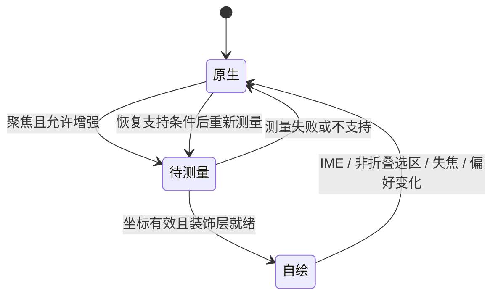

# 13 · 平滑光标：让插入点移动连续，也保留原生编辑能力

> **适用**：输入框的原生编辑行为已经稳定，要决定是否给插入点加平滑位移动画，以及加完会不会出现跟随滞后、与输入法候选窗不一致、两条光标互相闪的问题时。
> **本轮不可交付时**：若输入框本身还有打字卡顿、受控输入重建、输入法中断，停下并说明「基础手感未过关」，改读 [09-输入框的手感](09-输入框的手感.md)，本篇留到之后。
> **读完能判定**：是否只替换插入点的视觉表现、把输入与选区与撤销继续交给原生控件；接管与降级的时序、卸载时清理什么；镜像测量要同步哪些因素、缓存键包含什么；rAF 能减少什么、不能消除什么；哪些场景必须保留原生表现，哪些参数只是候选而非标准。

[系列目录](../../README.md) · 前置阅读：[输入框的手感](09-输入框的手感.md)

有些输入框在连续打字时，文字立即出现，细光标则从上一个插入点短促地滑向下一个位置；输入期间光标持续可见，停下来后才闪烁。用户感到更连贯，可能就来自这个很小的细节。

这类做法通常叫平滑光标（smooth caret / caret animation）。一种实现是隐藏原生光标，另画一个装饰层，持续测量真正插入点的位置，再对装饰层做动画。它比普通的边框渐变复杂，适合在原生输入已经稳定之后作为可选增强。

本篇由一段用户提供的输入框分析引出。以下解释这种技术路线及其边界；未取得被分析页面的源码、运行记录，不能据此确认那个页面确实采用了相同缓存、调度或动画参数。

## 改变的是插入点的显示方式

要区分两个经常都叫“光标”的东西：鼠标指针（cursor）与文本插入光标（caret）。这里讨论后者。

保留真正的 `<input>` 或 `<textarea>` 处理输入、选区、撤销、复制粘贴和输入法，只替换插入点的视觉表现。不要为了画得顺滑，把整套编辑行为重新做一遍。

```text
原生编辑控件：文字、焦点、selectionStart / selectionEnd、IME
        ↓ 读取当前编辑状态
镜像测量：排版参数、可用宽度、插入点与滚动偏移
        ↓ 得到目标坐标
装饰光标：定位、短位移动画、输入后重新开始闪烁计时
```

装饰层不接收焦点、不拦截指针，且从无障碍树隐藏。镜像也不应被读屏器当作第二份内容；不能以 `display: none` 隐藏它后又期待正常测量，因为那样没有可测的布局盒。

只有确认装饰光标已在正确位置显示后，才用 `caret-color: transparent` 隐藏原生光标。尚未测出、测量失败或决定降级时，应恢复控件原有的 caret 样式，而不是留下一个没有光标的输入框。

## 接管与降级要有明确时序



待测量阶段继续显示原生光标。测量成功后先把装饰层直接定位，再在同一次显示更新中显示它并隐藏原生；降级时恢复原生并隐藏装饰层。恢复增强也必须重新测量，不能播放从旧坐标追到新坐标的入场动画。

两条不变量是：聚焦且选区折叠时，不出现额外的光标空窗；接管成功时，不同时显示两条插入光标。遇到非折叠选区则尊重原生的选区表现，不强求仍画一根竖线。卸载时取消待执行的 rAF、闪烁定时器与监听，旧回调不得再隐藏原生光标。

## 镜像测量不是“字数乘字宽”

比例字体中，`i` 和 `W` 宽度不同；字偶距、连字、Emoji、组合字符、双向文字和换行还会进一步影响位置。原生 `selectionStart` 等偏移通常按 UTF-16 码元计数，也不是“用户看到的第几个字”。

常见做法是在不可见的镜像容器中复制文本排版，在目标偏移处测量标记或范围的位置。至少要同步：

| 类别 | 影响因素 |
|---|---|
| 字体 | 字族、字号、字重、字形变体、字距、行高、实际加载的字体 |
| 盒模型 | 内容宽度、padding、border、box-sizing |
| 排版 | white-space、自动换行、word-break、tab-size、方向与对齐 |
| 当前视图 | 控件内部滚动、坐标系、祖先变换、缩放与可见区域 |

单行 input 和多行 textarea 的空白、换行和滚动方式不同。末尾换行、连续空格、空文本也需要专门测，不能只拿英文句子验证。

在字符串中插入额外元素可能影响连字或文字塑形，普通镜像也未必能完全重现浏览器内部文本控件的排版。RTL / 双向文字中，一个逻辑偏移还涉及视觉方向与边界位置。镜像是一种近似还原策略，“精确”是要逐场景验证的结果，不是采用镜像后自动获得的能力。

## 缓存需要知道什么时候失效

“内容 + 光标偏移 + 宽度 + 样式版本 + 字体代次”是合理的缓存起点。字体代次可以理解为：实际可用字体发生变化时，增加一个版本号，避免复用字体加载前的旧测量。

还要先决定缓存的坐标是什么：

- 若缓存内容坐标，滚动时可以复用排版测量，但显示时要正确扣除 `scrollLeft` / `scrollTop`，再换算到光标层所在坐标系。
- 若缓存最终屏幕坐标，滚动、页面位置变化和视口变化都会让结果失效。

样式变化不只来自输入框自身。主题可能换字重，容器可能变宽，自动增高可能触发换行，浏览器缩放或字体加载也可能改变布局。不要只在 `input` 事件中更新；选区变化、方向键移动、点击定位、滚动和程序设置选区也可能需要更新。

缓存还应有大小限制或淘汰规则。持续输入会产生大量不同内容，逐份永久保存全文与测量结果，可能让优化本身变成内存负担。密码字段不应把明文复制进普通镜像或缓存，通常直接保留原生表现更合适。

## rAF 能安排工作，不能消除工作

`requestAnimationFrame` 提供帧前回调，不自带强制的“读阶段”和“写阶段”。读写分组是实现自己维护的调度约定。

把多个组件的布局读取集中处理，再批量写入，可以减少反复读写造成的布局抖动。但镜像内容和样式改变后读取几何信息，仍可能需要浏览器计算样式与布局。仅把代码放进 rAF，不保证不发生强制同步布局。

“只走合成层”通常是在描述**测量完成后，装饰光标用 transform 移动的动画阶段**。这类动画在合适条件下有机会由合成线程处理；测量、缓存失效、坐标计算和 DOM 更新仍有成本，是否合成也需要性能记录确认。

不要给每个输入框都永久加 `will-change` 来换取安心。额外图层也消耗资源，应按实际瓶颈决定。可以用浏览器 Performance、绘制提示和图层工具，观察快速输入时到底花费在哪一步。

## 位移与闪烁是两条时间线

用户给出的 2px、80ms、1s，分别对应视觉宽度、位移动画时长和闪烁周期。它们是一个可能的方案，不是平台标准；1s 周期还需要明确亮与灭各持续多久。

**位移时间线**：首次聚焦或首次有效测量时直接放到目标点，避免从容器原点滑入。之后短距离移动才做短过渡；高频输入时要能转向最新目标，不能把每个按键排成一个待播放队列。

80ms 的光标滑动意味着装饰光标在这段时间内仍处于追赶状态。连续高速输入时，平滑与滞后之间需要取舍，可以缩短时长或超过距离阈值直接跳转。文字与原生编辑位置必须即时更新，不随动画一起延迟。

跨行、Home / End、点击远处位置时，也未必适合画一条斜线飞过去。可采用直接定位，或为这些操作单独制定过渡规则。输入框滚动时光标要与文字同步，不能把滚动偏移也当成需要缓动的距离。

**闪烁时间线**：每次有效编辑或插入点移动后，立即使光标可见并重置空闲计时，空闲后才闪烁。不要在每次 rAF 测量、滚动或 ResizeObserver 回调时无差别重置，否则光标可能永远不进入空闲状态。

复位应与本次显示更新协调，避免先消失一帧再出现。也不要通过反复强制重排来重启动画，抵消前面的调度收益。重置逻辑还需在失焦和卸载时清理。

原生光标本来就可能在输入时保持可见或重置闪烁，其行为受平台、浏览器和系统设置影响。因此不能把这种优化的原因概括为“原生每按一个字都闪一下”。需要区分离散位置跳转、正常空闲闪烁，以及实现缺陷造成的短暂消失。

## 选区、输入法和系统偏好决定降级策略

| 场景 | 可采用的策略 |
|---|---|
| 未聚焦或页面失去激活 | 隐藏装饰光标，遵循原生编辑状态 |
| 非折叠选区、拖动选择 | 通常暂停装饰光标，保留原生选区表现 |
| IME 组合输入 | 未验证可靠时，整段恢复原生光标，结束后重测再启用 |
| 密码、不可测控件类型 | 保留原生表现，不强行接管 |
| 移动端选择手柄与放大镜 | 不覆盖系统交互，按设备验证或降级 |
| 减少动效、强制颜色模式 | 默认恢复原生光标，避免丢失系统可见性偏好 |
| 测量无效或严重失配 | 立即恢复原生光标，并停止错误动画 |

装饰光标改变不了输入法候选窗的真实定位。浏览器仍依据原生编辑状态定位候选窗，自绘光标落后或错位时，两者可能分离，必须实际验证。

自绘光标也未必自动继承系统光标粗细、闪烁速度与不闪烁偏好。`prefers-reduced-motion` 不能覆盖所有这些设置；需要可关闭的增强选项或更保守的启用范围。读屏器仍依赖真实控件的名称、值与选区，装饰层不能取代这些语义。

## 如何判断值得采用

先在同一输入框对比原生与自绘两种模式，测试快速打字、中间编辑、方向键、跨行、选区、中文候选、Emoji、RTL、缩放、字体切换与内部滚动。观察光标是否与真实插入点一致，而不只是慢速录屏中是否好看。

再看性能记录：输入延迟有没有增加，镜像测量是否反复触发布局，长文本是否退化，缓存是否增长失控。只有视觉连续性的收益大于跟随延迟与兼容成本，才值得启用。

这是一种有辨识度的细节增强，不能用来修饰受控输入重建、输入法中断或慢计算造成的卡顿。第 09 篇里的基础编辑问题应先解决。

## 用对照和测量区分收益与成本

做对照时保留同一个原生控件来切换原生、80ms 与 320ms 三档，减少不同内容和焦点位置对比较的干扰。自绘只覆盖桌面精细指针下的单行可打印 ASCII；中文、Emoji、非折叠选区、IME、移动设备与系统偏好应回到原生。多行模式用于验证降级，不能宣称已经解决通用的 textarea 镜像。

测量矩阵应继续覆盖软换行前后、末尾换行、双向边界、选区方向、RTL 横向滚动与字体切换。自绘的窄支持范围不能替代这些场景的验证。性能录制方法见[第 06 篇的操作步骤](06-状态动效与性能.md)。

参考：[MDN caret-color](https://developer.mozilla.org/en-US/docs/Web/CSS/caret-color)、[MDN selectionStart](https://developer.mozilla.org/en-US/docs/Web/API/HTMLInputElement/selectionStart)、[MDN requestAnimationFrame](https://developer.mozilla.org/en-US/docs/Web/API/Window/requestAnimationFrame)、[MDN CSS Font Loading API](https://developer.mozilla.org/en-US/docs/Web/API/CSS_Font_Loading_API)、[避免布局抖动](https://web.dev/articles/avoid-large-complex-layouts-and-layout-thrashing)。
