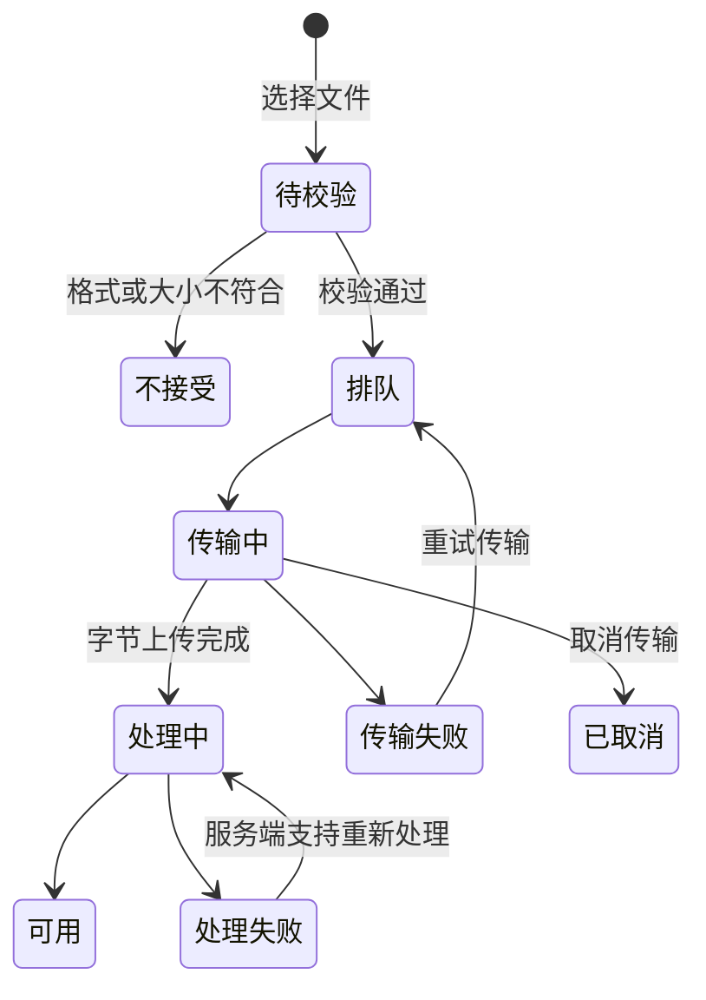

# 14 · 上传与附件：从选中文件到处理完成

> **适用**：要做或验收「多文件选择→校验→传输→服务端处理」这条完整队列，尤其是失败重试、同名文件、取消与移除怎么分文案时。
> **本轮不可交付时**：若这一轮只是表单里随提交带一个文件、没有服务端处理阶段和队列，停下并说明「没有上传队列」，改读 [02-导航与表单](02-导航与表单.md) 的上传控件那几条。
> **读完能判定**：传输完成与服务端处理完成是否分开呈现；多文件里单个失败怎么呈现、是否只重试失败项、进度会不会串到别的文件；取消传输、移除队列项、删除已保存附件是不是三个不同动作；重试按什么防重、超时后是否先查服务端；同名文件与重复选择同一文件算什么；上传中关闭界面到底继续还是取消；失败原因是否具体；本地预览的对象 URL 是否释放。

[系列目录](../../README.md) · 下一篇：[保存与草稿](15-保存与草稿.md)

用户一次选了三份项目材料：两份成功，一份传完后解析失败。界面若只显示一个总进度和“上传失败”，用户不知道该重传哪份，也不知道已经传完的文件是否还在。

上传是任务队列，不只是一个文件选择按钮。文件在服务端可用，才算完成对应任务。

## 把传输与处理分开

“100%”若只表示传输完成，后面要明确写“正在扫描 / 解析”，不能让用户误以为已经可下载。服务器是否支持重新处理、是否需要重传，由实际接口决定，不应在 UI 上虚构重试能力。

## 选择之前说明限制

显示允许格式、单文件大小、数量上限及是否允许多选。`accept` 帮助文件选择器筛选，不替代前后端校验，更不是安全检查。

拖拽上传必须同时有“选择文件”按钮。拖入无效类型时显示拒绝原因；不要让文件落到页面后被浏览器直接导航打开。拖放区域的高亮只表达是否可接收，不应在拖动路径上反复闪烁。

同名不等于同一文件。产品应明确同名文件是并存、覆盖、生成新版本，还是拒绝；如果可能覆盖，提交前说清楚对象。重复选择同一文件时，要能判断是用户重试还是新增，不能默默生成多份附件。原生文件选择器的 `change` 行为也需检查，必要时在完成处理后正确重置选择入口。

## 三个文件中一个失败

| 文件 | 状态 | 用户可做什么 |
|---|---|---|
| 需求说明.pdf | 可用 | 查看、下载、按权限移除 |
| 页面截图.png | 可用 | 查看、下载、按权限移除 |
| 项目清单.xlsx | 处理失败：缺少“项目编号”列 | 查看原因、修正后替换；或按实际能力重试处理 |

总摘要可以显示“2 个可用，1 个需要处理”，单项仍保留自己的结果。只重试失败文件，不要把成功附件清空再传。给队列项稳定 ID；列表重排不应让进度跑到另一个文件上。

已知字节总量时显示真实传输进度；多文件总进度若按字节加权，就明确它不是“已完成文件比例”。未知总量或服务端处理阶段可使用不确定进度和文字，不编造百分比。进度播报应节制，避免读屏器每秒反复报数。

## 取消、移除与删除不是同一个动作

取消传输通常停止当前客户端任务，但服务端可能已收到部分或全部数据，需要清理临时对象。移除队列项可能只影响当前页面；删除已保存附件则是服务端业务操作，可能不可逆。这三者的文案和后果要分开。

重试需按上传任务或文件版本防重；网络超时时先确认服务器已有对象或任务状态，避免一次重试产生两个附件。大文件可考虑分片、断点续传与校验，但“能够续传”必须有后端协议、过期规则和实际验证支持。

上传中关闭对话框，文件是后台继续传、暂停，还是取消？选择一种并明确告诉用户。页面关闭后，一般不能承诺普通页面脚本仍会完整上传；需要持久任务支持时，应提供重新进入后的状态查询。浏览器离开提示不可靠，不能成为唯一保护。

## 文件可用之后仍有界面细节

附件名要可完整阅读，失败原因不能只写“错误 500”。上传列表中同名文件应有足够信息区分。预览暂不可用时仍可提供合法的下载入口；权限撤销或文件删除后，旧预览也要正确失效。

本地预览使用对象 URL 时，替换或移除后释放不再需要的 URL，避免不断积累内存。不要在界面暴露服务端存储路径或将其当作可访问文件名。

## 验收路径

选三份文件，一份过大、一份传输断网、一份成功；修复后只重试失败项。再测试取消正在传输的文件、解析失败、同名覆盖、重新选择同一文件、关闭再返回、权限变化。确认每项状态可追溯，成功项不会因其他项失败而丢失。

参考：[MDN 文件输入](https://developer.mozilla.org/en-US/docs/Web/HTML/Element/input/file)、[MDN File API](https://developer.mozilla.org/en-US/docs/Web/API/File_API)、[MDN revokeObjectURL](https://developer.mozilla.org/en-US/docs/Web/API/URL/revokeObjectURL_static)。
