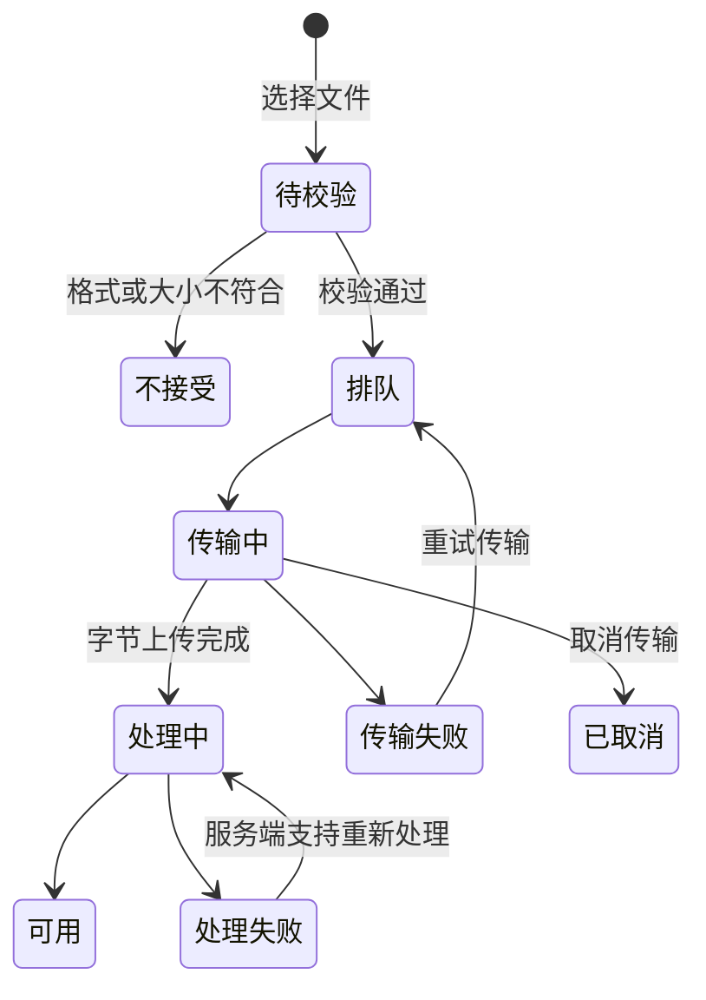

# 14 · 上传与附件：从选中文件到处理完成

> **适用**：要做或验收「多文件选择→校验→传输→服务端处理」这条完整队列，尤其是失败重试、同名文件、取消与移除怎么分文案时。
> **本轮不可交付时**：若这一轮只是表单里随提交带一个文件、没有服务端处理阶段和队列，停下并说明「没有上传队列」，改读 [02-导航与表单](02-导航与表单.md) 的上传控件那几条。
> **读完能判定**：传输完成与服务端处理完成是否分开呈现；多文件里单个失败怎么呈现、是否只重试失败项、进度会不会串到别的文件；取消传输、移除队列项、删除已保存附件是不是三个不同动作；重试按什么防重、超时后是否先查服务端；同名文件与重复选择同一文件算什么；上传中关闭界面到底继续还是取消；失败原因是否具体；本地预览的对象 URL 是否释放。

## 一、先判

1. **上传是任务队列，不只是一个文件选择按钮**：文件在服务端可用，才算完成对应任务；选完文件不等于传完。
2. **传输完成与处理完成分开呈现**：「100%」若只表示字节传完，后面要明确写「正在扫描 / 解析」，不能让用户误以为已经可下载；服务器是否支持重新处理、是否需要重传，由实际接口决定，不在 UI 上虚构重试能力。
3. **选择之前说明限制**：显示允许格式、单文件大小、数量上限及是否允许多选；`accept` 只帮助文件选择器筛选，不替代前后端校验，更不是安全检查。
4. **拖拽上传必须同时有「选择文件」按钮**：拖入无效类型时显示拒绝原因；不要让文件落到页面后被浏览器直接导航打开；拖放区域的高亮只表达是否可接收，不在拖动路径上反复闪烁。
5. **同名不等于同一文件**：明确同名文件是并存、覆盖、生成新版本还是拒绝，可能覆盖时提交前说清对象；重复选择同一文件要能判断是用户重试还是新增，不能默默生成多份附件；原生文件选择器的 `change` 行为也要检查，必要时在完成处理后重置选择入口。
6. **单个失败单独呈现**：总摘要可以显示「2 个可用，1 个需要处理」，单项仍保留自己的结果；只重试失败文件，不要把成功附件清空再传；队列项给稳定 ID，列表重排不应让进度跑到另一个文件上。
7. **进度不编**：已知字节总量时才显示真实传输进度，多文件总进度若按字节加权就说明它不是「已完成文件比例」，未知总量或服务端处理阶段用不确定进度加文字；播报要节制，避免读屏器每秒反复报数。
8. **取消、移除、删除是三个动作**：取消传输停止当前客户端任务，但服务端可能已收到部分或全部数据、需要清理临时对象；移除队列项可能只影响当前页面；删除已保存附件是服务端业务操作，可能不可逆。文案与后果要分开。
9. **重试要防重**：按上传任务或文件版本防重；网络超时时先确认服务器已有对象或任务状态，避免一次重试产生两个附件。分片、断点续传与校验，必须真有后端协议、过期规则和实际验证支持才成立。
10. **上传中关闭界面要说清后续**：对话框或页面关闭后，文件是后台继续传、暂停还是取消，选一种并明确告诉用户。页面关闭后一般不能承诺普通页面脚本仍会完整上传；需要持久任务时，提供重新进入后的状态查询，浏览器离开提示不可靠，不能成为唯一保护。
11. **文件可用之后仍有界面细节**：附件名要可完整阅读，失败原因不能只写「错误 500」，列表里同名文件要有足够信息区分；预览暂不可用时仍提供合法的下载入口，权限撤销或文件删除后旧预览要正确失效。
12. **本地预览的对象 URL 要释放**：替换或移除后释放不再需要的 URL，避免不断积累内存；不要在界面暴露服务端存储路径，也不要把它当作可访问文件名。

## 二、做完的标准

- [ ] 选三份文件，其中一份过大、一份传输断网、一份成功：三行各有状态与可做的动作，总摘要与单项互不覆盖。
- [ ] 修好断网那份后只重试失败项，成功项的文件 ID 与内容不变，网络面板里没有第二次上传。
- [ ] 传一份会解析失败的文件，界面给出具体失败原因（例如缺少某列）与「修正后替换 / 按实际能力重试处理」。
- [ ] 取消一个正在传输的文件、移除一个队列项、删除一个已保存附件：三者文案与结果不同，取消后服务端没有留下孤儿对象。
- [ ] 同名覆盖与重复选择同一文件各试一次，用户能分辨这是新增还是重试。
- [ ] 上传中关闭再返回，界面给出的状态与产品选择一致（继续 / 暂停 / 取消）；权限变化后旧预览失效。
- [ ] 全程结束后本地对象 URL 已释放，没有残留的 blob 占着内存。

## 三、依据与数值

- 总进度按字节加权是**项目起点**，不是标准：多文件时它不等于「已完成文件比例」，要就地说明这个差别的口径。
- 「错误 500」这类文案不合格属**判定**，本篇不给出文案门槛；也没有 WCAG 条号或对比度门槛。
- 分片、断点续传、重新处理属**平台与后端能力**：没有协议、过期规则和实测支持，就不是可承诺的功能。

## 四、控件、表格与示例

传输与处理是两个阶段：

三个文件中一个失败时的队列呈现：

| 文件 | 状态 | 用户可做什么 |
|---|---|---|
| 需求说明.pdf | 可用 | 查看、下载、按权限移除 |
| 页面截图.png | 可用 | 查看、下载、按权限移除 |
| 项目清单.xlsx | 处理失败：缺少“项目编号”列 | 查看原因、修正后替换；或按实际能力重试处理 |

## 五、失败长相与边界

- **界面只显示一个总进度和「上传失败」** → 用户不知道重传哪份、也不知道已经传完的文件是否还在；把单项状态与总摘要分开呈现。
- **「100%」之后没有下文，文件却还不能用** → 处理阶段没有单独呈现，或把「传完」冒充成「可用」。
- **一份失败导致已成功的附件被清空重传** → 重试粒度过粗；只重试失败项，并给队列项稳定 ID。
- **重试后出现两个一样的附件** → 没有按上传任务或文件版本防重，也没有在超时后先查服务端状态。
- **进度条忽然从某个文件的进度跳到另一个文件** → 列表重排时按位置而不是按稳定 ID 追踪进度。
- **点「移除」把服务端附件也删了，或反过来只删了队列项** → 取消 / 移除 / 删除三个动作混用了同一套文案与接口。
- **边界**：`accept` 不是安全检查；服务端处理能力（重新处理、续传、版本）不确定时 UI 不虚构；拖放高亮不反复闪烁；浏览器离开提示不可靠，不能当唯一保护。

参考：[MDN 文件输入](https://developer.mozilla.org/en-US/docs/Web/HTML/Element/input/file)、[MDN File API](https://developer.mozilla.org/en-US/docs/Web/API/File_API)、[MDN revokeObjectURL](https://developer.mozilla.org/en-US/docs/Web/API/URL/revokeObjectURL_static)。
